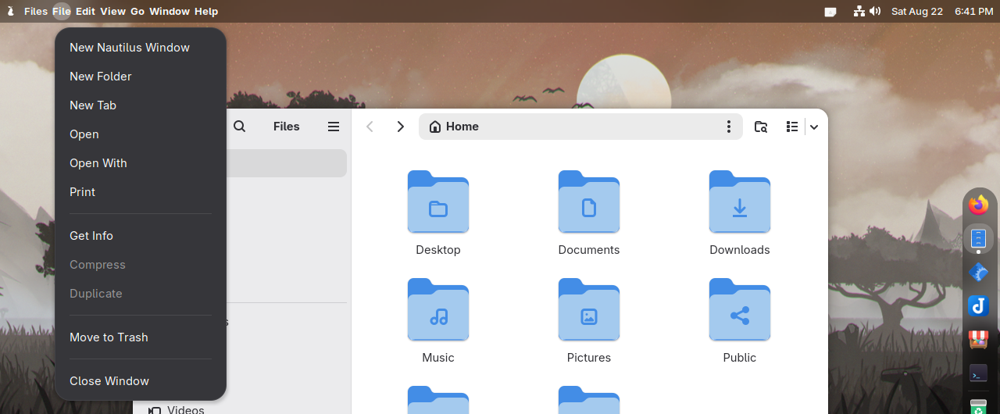
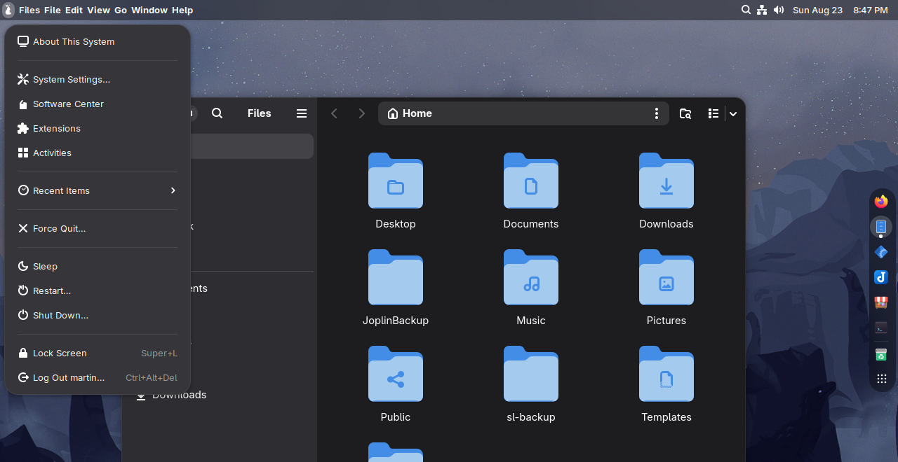
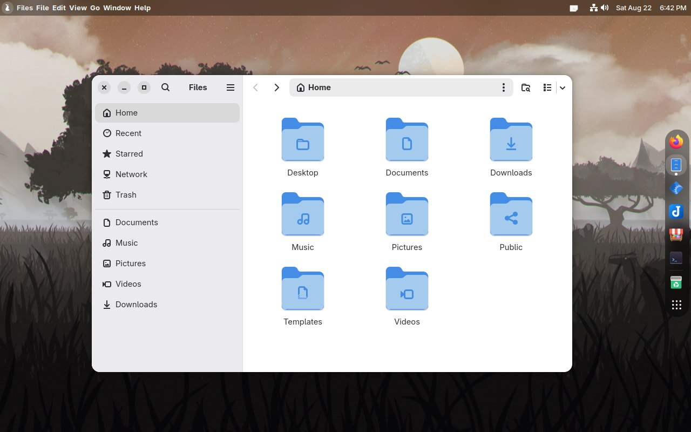
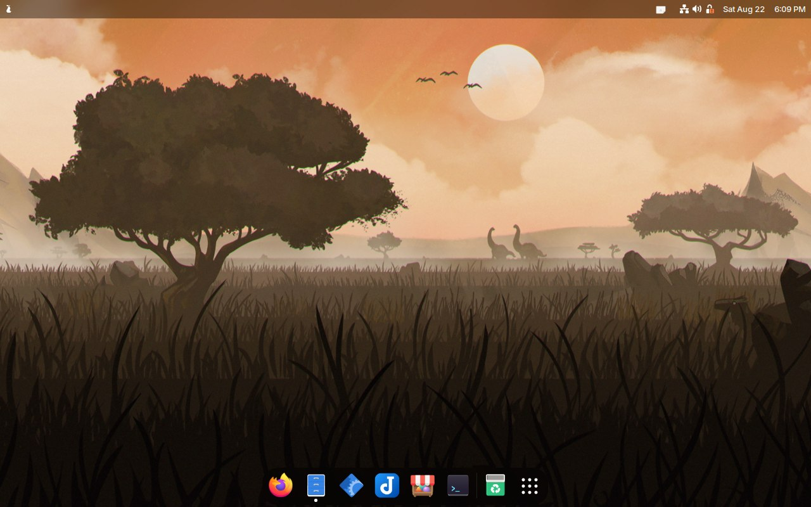
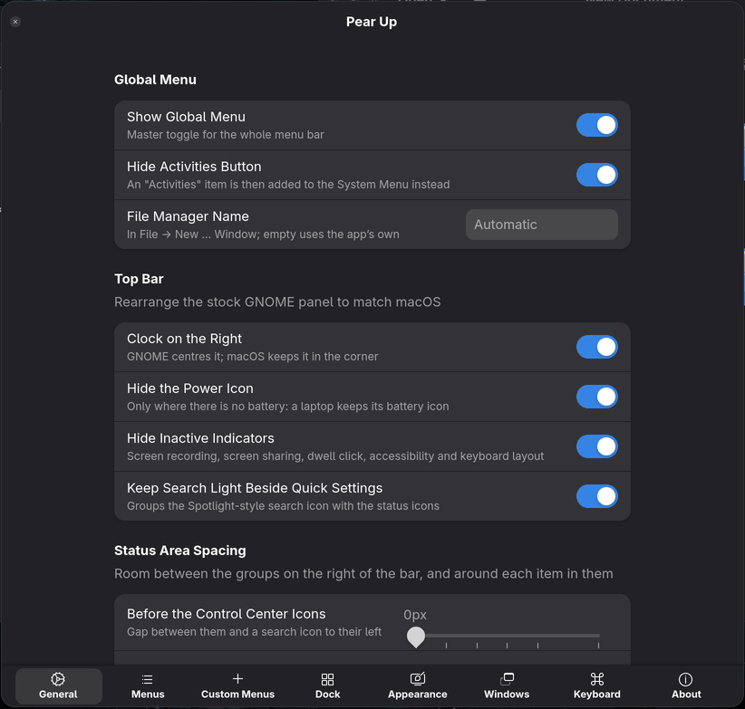
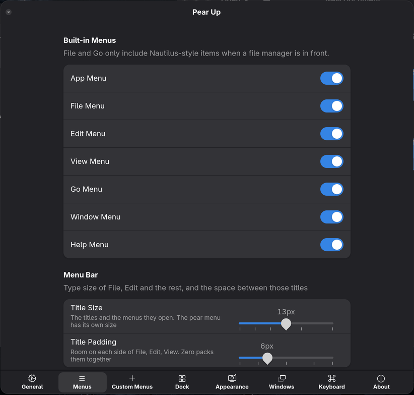
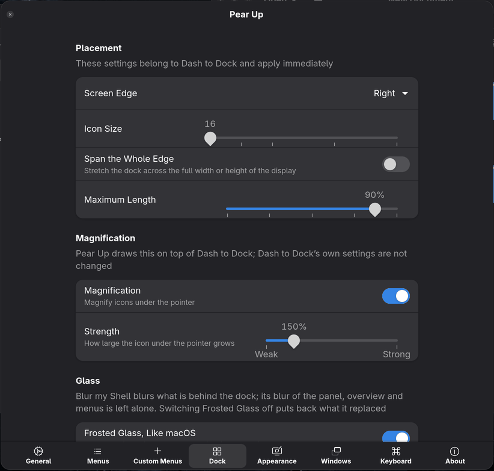
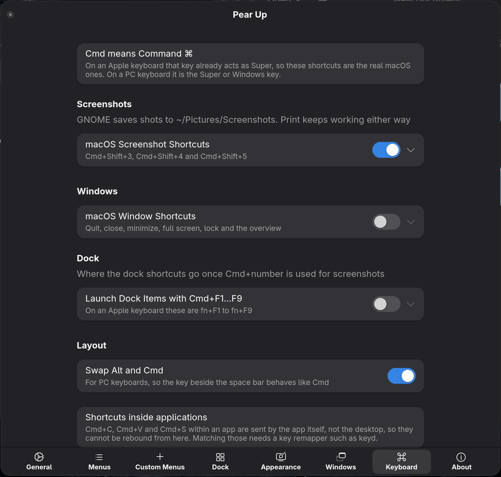

# Pear Up

**Pear up your GNOME.** A macOS-like desktop in a single GNOME Shell extension: a global menu bar for
the focused app, a system menu behind a bitten pear, the clock in the corner, window buttons on the
left, and one settings window that also drives your dock.

> Not affiliated with Apple. The pear is the joke.

The menu engine came from
[Global Menu for GNOME](https://github.com/ShiroOSL/global-menu-for-gnome) by
ShiroOSL — published on
[extensions.gnome.org](https://extensions.gnome.org/extension/10288/global-menu-for-gnome/)
and actively maintained there; see [Credits](#credits).



## What it does

**A global menu bar.** The focused application's name and its File, Edit, View, Go, Window and Help
menus live in the top bar instead of inside each window. Every menu can be switched off individually.
When no window is in front, the bar clears itself.

**A system menu.** The bitten pear on the far left opens the Apple menu's arrangement, group for
group: About This System; System Settings, your software centre and the extensions manager; Recent
Items; Force Quit (click the window, like xkill); Sleep, Restart and Shut Down; then Lock Screen and Log Out, each naming the
shortcut this system has bound to it. Every entry has an icon and every entry is optional — Activities,
the App Grid, a system monitor and a terminal are available too, off by default because the menu they
imitate has none of them. The icon can be any bundled distro logo, an Apple-style glyph, or your own
image.

**Recent Items**, split into Applications, Documents and Servers as macOS splits it, filled fresh each
time it opens. Two honest differences: Applications comes from the shell's usage statistics, so it is
what you use most rather than what you opened last — GNOME keeps no recently-used-application list —
and Clear Menu empties the recent *files* list, the same one GNOME Settings clears, which has no
effect on those statistics.



**A macOS-shaped top bar.** The clock moves to the far right with the status icons to its left, the
menu titles and the clock are set in regular type with only the app name bold, the power glyph a
machine without a battery shows is hidden (a laptop keeps its battery icon), GNOME's
usually-inactive indicators stop reserving space, and a
[Search Light](https://extensions.gnome.org/extension/5489/search-light/) icon can be grouped with
Quick Settings as a Spotlight stand-in. The gaps between the search icon, the control centre icons
and the clock are adjustable, as is the padding each item reserves around itself — the first spreads
the groups out, the second packs them closer than GNOME's own spacing allows. Indicators other
extensions add after login, such as the tray icon of an app that starts late, are spaced the same way
as they arrive. [Vitals](https://github.com/corecoding/Vitals), if you run it, gets its readouts set
closer together and a size smaller than the bar, as the stat readouts of macOS menu bar apps are.
The clock stays in its corner when another extension moves it back to the centre afterwards, as
Just Perfection does at its defaults whenever it is enabled.

**The rest of the desktop, where macOS has it.** Notifications appear in the top right corner, under
the clock, and the bubble a volume or brightness key brings up sits there too, under the bar, rather
than at the bottom of the screen. Switching desktops slides the desktop across with no popup, and the
overview always shows the desktops along its top, as Mission Control shows its Spaces, where GNOME
hides them until two are in use. And a login starts on the desktop rather than in the overview. With
Automatic Screen Brightness on, the screen fades to each new light level over a few seconds, quicker
brightening than darkening, as on macOS, rather than jumping there; the slider, the brightness keys
and dimming when idle still act at once. That one is for GNOME 49 and later, where the shell sets the
brightness itself. Each
is a switch of its own in the Desktop group of the General page, on by default, and switching one off
gives back what GNOME does.
[Just Perfection](https://extensions.gnome.org/extension/3843/just-perfection/) is no longer needed
for any of this, and neither is Dash to Dock's own switch for starting without the overview; left
installed at its defaults, Just Perfection does not get in the way.

**A search icon of its own.** Optional, and it sits where macOS keeps Spotlight. What it opens is a
setting: GNOME's own search, which needs nothing installed;
[Search Light](https://extensions.gnome.org/extension/5489/search-light/), if you have it; or any
launcher you name, such as `ulauncher` or `rofi`. Whatever the choice, it falls back to GNOME's
search when that thing is unavailable, so the button is never a dead end.

**Windows the way macOS has them.** Close, minimize and maximize on the left, in macOS order, and
smaller, at about the size macOS draws them. New windows are no longer maximized for being nearly as
large as the screen. With
[Rounded Window Corners Reborn](https://extensions.gnome.org/extension/7048/rounded-window-corners-reborn/)
installed, the corners are rounded and their radius is set here; with
[Magic Lamp](https://extensions.gnome.org/extension/3740/compiz-alike-magic-lamp-effect/), a minimizing
window folds into the dock like a genie lamp. Pear Up installs neither and switches each on and off through
the shell, as the Extensions app does. The small buttons are CSS, kept in a marked block of your own
`~/.config/gtk-4.0/gtk.css` and `~/.config/gtk-3.0/gtk.css` — one reaches libadwaita apps, the other GTK 3
apps and the Electron ones, such as Claude, ChatGPT and Cursor, that draw GTK 3 title buttons — which
apps read when they next start. Everything outside the block is left exactly as it is, and rules of your
own that already shrink the buttons are never removed.

**macOS type, accent, icons and cursor.** One switch sets the interface, document and window-title
fonts to Adwaita Sans — GNOME's own fork of Inter, shipped from GNOME 48, or Inter itself where that
is what is installed — with font hinting off, which is how macOS draws text; another sets the accent
color to blue. Two pickers choose the icon and cursor theme from what is installed, with
[MacTahoe](https://github.com/vinceliuice/MacTahoe-icon-theme),
[WhiteSur](https://github.com/vinceliuice/WhiteSur-icon-theme) and the
[macOS cursors](https://github.com/ful1e5/apple_cursor) first, and say where to get them, and how to
install them without root, when none is there. They are ordinary GNOME settings and reach every app,
and a switch, turned off again, puts back what was there before rather than a default.

**Dock control.** [Dash to Dock](https://extensions.gnome.org/extension/307/dash-to-dock/) is
configured from the same window: which screen edge it sits on, icon size, how much of the edge it may
use, whether it is always visible, hides when a window is in the way, or only appears when you point
at the edge, how running apps are marked — one dot like macOS, GNOME's own, or none — and which
display it belongs to. The grey backdrop Dash to Dock puts behind the app in front is removed, since
the macOS Dock marks it with its dot alone; a switch brings it back. Magnification works like the
macOS Dock: the icon under the pointer grows while its neighbours grow less and move apart. It is off
until you switch it on, and a slider then runs from weak to strong. Pear Up draws it on top of Dash
to Dock without changing any of Dash to Dock's settings, and clicks and drag-and-drop still go to
Dash to Dock's own icons.

**A frosted-glass dock.** With [Blur my Shell](https://extensions.gnome.org/extension/3193/blur-my-shell/)
installed, a Glass group on the same page turns the dock into the floating, frosted pill macOS has. One
switch sets the blur, a dark glass tint — a light one when GNOME's colour scheme is not dark — and the
brightness together; a Tint choice (transparent, light or dark) and a Brightness slider adjust it. Only the
dock's own blur is written: Blur my Shell's panel, overview and menu blur are left as they are, and so is
whether the dock's blur is static or dynamic. Switching it off puts back what it replaced. Pear Up installs
nothing; without Blur my Shell the group is a link to it. One catch, which the slider says: the brightness is
a setting of Blur my Shell's dynamic blur, and its static blur, the default, takes its brightness from a
pipeline of its own and ignores it.

| Right edge, always visible | Bottom edge, larger icons |
| --- | --- |
|  |  |

**macOS keyboard shortcuts.** Optional sets you can switch on or off. On an Apple keyboard Command
already acts as Super, so these are the real chords rather than an approximation; on a PC keyboard
read Cmd as the Super or Windows key.

| Shortcut | Does |
| --- | --- |
| `Cmd+Shift+3` | Whole screen straight to a file |
| `Cmd+Shift+4` | Pick a region, window or screen |
| `Cmd+Shift+5` | Screen recording |
| `Cmd+Q` | Quit the app, every window of it |
| `Cmd+W` | Close the window |
| `Cmd+M` | Minimize |
| `Ctrl+Cmd+F` | Full screen |
| `Ctrl+Cmd+Q` | Lock the screen |
| `Ctrl+↑` | Overview, like Mission Control |

Screenshots land in `~/Pictures/Screenshots`, and `Print` keeps working alongside. Each accelerator is
added next to GNOME's own rather than replacing it, so switching a set off leaves your own bindings
untouched. Where Dash to Dock already grabs a chord — it takes `Cmd+number` and `Cmd+Q` — the switch
stands that down and offers to move the dock shortcuts to `Cmd+F1…F9` instead.

Shortcuts *inside* an application, like `Cmd+C`, are sent by the app rather than the desktop and
cannot be rebound from here; matching those needs a key remapper such as `keyd`.

**Your own menus.** Add any number of extra top-level menus whose items run shell commands or send
keyboard shortcuts.

## Settings

Everything lives in one window — the panel layout, which menus appear, the dock, the type, accent,
icons and cursor, the windows, and your custom menus. Open it by pressing <kbd>Super</kbd> and typing "pear", from the app grid, or
through the Extensions app.

These settings cannot appear in GNOME Settings beside Appearance, which is where they arguably
belong: `gnome-control-center` compiles every panel into its binary and has no plugin interface, so
no extension can add one. Installing puts a **Pear Up Settings** application entry in its place.

| General | Menus |
| --- | --- |
|  |  |

| Dock | Keyboard |
| --- | --- |
|  |  |

## Requirements

- GNOME Shell 45 – 50, under Wayland. Every release in that range is checked by the
  [test suite](#testing) rather than assumed; 50 is also what it is used on daily.
- Optional: [Dash to Dock](https://extensions.gnome.org/extension/307/dash-to-dock/) for the Dock page
- Optional: [Rounded Window Corners Reborn](https://extensions.gnome.org/extension/7048/rounded-window-corners-reborn/)
  and [Magic Lamp](https://extensions.gnome.org/extension/3740/compiz-alike-magic-lamp-effect/) for the rounded
  corners and the genie effect on the Windows page. Without them that page says so and links to them.
- Optional: [Blur my Shell](https://extensions.gnome.org/extension/3193/blur-my-shell/) for the frosted
  glass of the Dock page. Without it that group says so and links to it.
- Optional: [Search Light](https://extensions.gnome.org/extension/5489/search-light/) for
  Spotlight-style search — but note it **ends a Wayland session on GNOME 50** when its icon is
  clicked, until the fix in [`contrib/`](contrib/README.md) is applied. The search button here
  defaults to GNOME's own search, which needs nothing installed and cannot be broken by a third
  party.

Applications are opened through their desktop files where possible, with fallbacks, so the menu
entries work across distributions rather than assuming GNOME's defaults.

## Install

```bash
git clone https://github.com/maddinek/pear-up.git
cd pear-up
bash install.sh
```

Then log out and back in — GNOME does not load new extension code into a running Wayland session —
and enable **Pear Up** in the Extensions app or Extension Manager.

To remove it:

```bash
bash uninstall.sh
```

By default this only removes the extension's own files. Changes made from the Preferences
window to settings owned by other parts of the desktop — the macOS shortcut sets appended
to GNOME's keybindings, the Alt/Cmd swap in `xkb-options`, the Dash to Dock hot keys stood
down for them, and the window button layout — are left in place. To revert those as well:

```bash
bash uninstall.sh --reset-settings
```

That removes exactly the accelerators this extension added (leaving any of your own on the
same actions alone) and resets the other keys only while they still hold the values it
wrote, printing what was restored. What the Appearance page set is not among them: switch the
type and accent off there first if you want your old ones back, and pick the icon and cursor
theme again. The same goes for the Windows page: switch Small Window Buttons off there to take its
block out of the two `gtk.css` files, Don't Maximize New Windows to put GNOME's value back, and the
rounded corners and the genie effect off to leave those extensions as you found them; and for Frosted
Glass on the Dock page, which puts back the blur, tint and brightness it replaced.

## Testing

Both suites run in containers, so no other system has to be installed and nothing touches the
desktop you are using.

**Does it still behave?** Boots a real GNOME Shell headless against a virtual monitor, loads the
extension the way a login would, and checks what it actually did to the panel: the clock moved, and
back in its corner after another extension moves it, notifications and the volume bubble in the top
right corner, no popup when switching desktops, the overview's desktops always shown, the session
starting on the desktop, automatic brightness fading with no step over 5% while the slider and dimming
act at once, the System Menu appeared with its entries, the power icon is hidden but a
battery is not, the titles and clock are regular weight with the app name bold, an indicator added
after start-up is spaced like the rest, Vitals' readouts take Pear Up's spacing and type over their
own stylesheet's, the bar stays bare while nothing is in front, the File, Edit, View, Go, Window and
Help menus appear once a window is focused, File and Go stay generic unless a file manager is in
front, and disabling it leaves nothing behind.

With Dash to Dock installed in the same container, a virtual pointer then hovers the dock, on the right
edge and along the bottom: the icon under it has to reach exactly the chosen size, its neighbours less
and pushed outward, and leaving the dock, switching magnification off mid-hover or disabling Pear Up
has to give every icon its opacity back and leave no overlay behind.

The menus are asserted rather than clicked. Activating them through the structure runs the same code
a click would, without depending on pixel coordinates or animation timing, which is where interface
tests usually become unreliable.

```bash
tests/integration/run.sh        # GNOME 50
tests/integration/run.sh 48     # GNOME 48
```

This is the suite worth trusting, because the interesting failures are about timing rather than
missing functions. The power icon survived two fixes precisely because every API involved existed —
it was being hidden before the thing that draws it had been built.

All six releases pass it, which is why `shell-version` claims them:

| GNOME | 45 | 46 | 47 | 48 | 49 | 50 |
| --- | --- | --- | --- | --- | --- | --- |
| Behaviour | ✅ | ✅ | ✅ | ✅ | ✅ | ✅ |
| Screenshot artifact | — | ✅ | ✅ | ✅ | ✅ | ✅ |

Nothing for tests is shipped in the extension. Inspecting a running shell needs a way in — a headless
session has no Looking Glass, and `Eval` refuses to run without the unsafe mode only Looking Glass
can enable — so that capability lives in a separate extension under `tests/integration/hook-extension`
that exists only inside the container.

The screenshot is a convenience, not evidence: whether a recording can be made depends on the
release and the container's media stack, and 45 manages none. The assertions are what matter.

**Do the APIs still exist?** Resolves every GNOME API the extension touches against a given version:
introspected symbols, and the private shell internals that no typelib describes, which are the ones
that vanish quietly between releases.

```bash
tests/run-api-matrix.sh             # every version in the table
tests/run-api-matrix.sh 48 50       # just these
```

`tests/api-manifest.json` is the list of what is depended upon, kept by hand so each entry is a
deliberate statement rather than a grep result.

**Do the preferences still open?** Preferences run in their own process, so nothing above touches
them: a property libadwaita dropped, or a method that never existed, shows up only when the window is
opened — as an empty window and a stack trace in the journal. This builds every page headlessly and
fails on the first throw, then drives the rows that change settings of the desktop itself — the
Appearance and Windows switches and pickers, the Dock page's frosted glass and the shortcut sets —
against the container's own in-memory settings, and checks that the values the user had come back. The
pickers are run once more with fixture icon and cursor themes dropped into the container's XDG
directories, and the Windows page once more with the two extensions it drives installed. Its `gtk.css`
switch works on a config directory the runner makes, and the check is that every byte outside the block
is as it was. The Dock page is run with Blur my Shell absent, installed with the schemas of its dock,
panel and popup components, and installed without them, and the check for the second is that nothing but
the dock's four keys is ever written.

```bash
tests/run-prefs-smoke.sh            # every version in the table
tests/run-prefs-smoke.sh 49 50      # just these
```

**Clicking things in a VM.** GNOME 50 drives its panel buttons with
`Clutter.ClickGesture`, which ignores the synthetic pointer a hypervisor injects — the pointer moves
and hovers, but no button ever activates, and the shell's own clock is just as unresponsive. Mutter's
RemoteDesktop interface goes through the compositor's input path instead, which Clutter cannot tell
from hardware:

```bash
tests/vm/rd-click.py 1038 13        # click, in screen coordinates
tests/vm/rd-click.py 640 400 --move-only
```

Run it inside the session under test. This is what verified the search button's three backends, that
clicking Search Light no longer ends the session, and the menu items that only mean something with a
real application in front: minimising a window, sending a shortcut an application listens for, and
raising a window from the list of open ones.

That last group is the edge of what the automated suites reach. The headless container has a shell
but no applications, so it can prove the menu bar is built correctly and cannot prove that a menu
item does what its label says. Those stay a manual pass in a VM, with clicks injected as above.

**Do the helpers that reach into settings behave?** The undo logic in uninstall.sh does string
surgery on printed GVariant lists, and the dock script forwards its opt-outs through a quoted heredoc
— exactly the kind of code that reads fine and eats someone's keybindings. Both are checked against
fakes (a stubbed `gsettings`, a stubbed `ssh`) with no system touched:

```bash
tests/check-uninstall.sh    # accel removal keeps neighbours; resets only untouched values
tests/check-dock-script.sh  # DOCK_SET_FAVORITES actually reaches the remote shell
```

**Do the menu templates stay pure?** The templates are shared constants, so everything built from
them must be a copy. `tests/check-menu-templates.js` asserts token-exact file-manager detection, what
each menu contains, and that mutating a built menu cannot reach the template underneath. It needs a
real `gjs`, so it runs inside the API matrix containers rather than on the host.

**Does it lint?** `eslint.config.mjs` carries the recommended rules and GJS's globals — deliberately
nothing stylistic, so the signal stays the class of mistake that reads fine and breaks at runtime.

```bash
tests/run-lint.sh                   # in a container, needing no Node on the host
npm ci && npx eslint .              # if you have one
```

Everything except the integration suite also runs in [CI](.github/workflows/ci.yml) on every push.
The checks themselves live in `tests/lib/check-*-here.sh` and run against whatever GNOME is on the
machine that invokes them — locally that machine is a container started by the scripts above, in CI it
is the job container. One implementation either way, so a check cannot pass in CI and fail on a
desktop.

The integration suite stays local: it boots systemd in a privileged container to get logind, and a
runner is the wrong place to find out that has broken.

The workflow itself is verifiable without pushing, which is worth doing before trusting a green tick:

```bash
act --list                      # does it parse, and what would run
act -j api --matrix gnome:50    # run one job here
```

Neither suite replaces reading GNOME's porting notes when a new release lands, and a passing API
matrix is not grounds on its own for widening `shell-version` — behaviour has to be checked too.

## Releases

Build the distributable zip with:

```bash
scripts/pack.sh          # dist/pear-up@maddinek.github.io.shell-extension.zip
```

`gnome-extensions pack` ships only `extension.js`, `prefs.js`, `metadata.json`,
`stylesheet.css` and the schemas, so every other runtime file has to be named — the script holds
that list, because getting it wrong produces a zip that installs and then fails on a machine that
is not this one. Tests, screenshots, the contrib patch and the lint tooling are all deliberately
left out.

[The changelog](CHANGELOG.md) records what each version contains. Two version fields, because they
answer different questions:

| Field | | |
| --- | --- | --- |
| `version` | integer, +1 every published build | what GNOME compares |
| `version-name` | `major.minor.patch` | what a human reads |

Bump both in the commit that ships, and only once the API matrix, the preferences smoke test and the
integration suite have passed on every release in `shell-version`.

## Credits

Pear Up took the menu work over from
[global-menu-for-gnome](https://github.com/ShiroOSL/global-menu-for-gnome) by
[ShiroOSL](https://github.com/ShiroOSL), published on
[extensions.gnome.org](https://extensions.gnome.org/extension/10288/global-menu-for-gnome/). It is a
separate project, not a continuation of that one.

**The global menu itself is their work.** Specifically, still largely as they wrote it:

- **`menuManager.js`** — building the menus, and the handlers behind every entry in them
- **`systemMenu.js`** — the System Menu behind the logo, and what it launches
- **`prefs.js`** and the settings schema — roughly half the preferences, and most of the keys

The rest of the project is not theirs and should not be read as such:

- **`menuTemplates.js`** — which items File, Edit, View, Go, Window and Help show
- **`extension.js`** — panel arrangement, the clock, indicator handling, lifecycle
- **`stylesheet.css`** — all of the macOS styling
- The Dock, Keyboard and window-button integration, which drive settings outside this extension
- `tests/` — the container test suites
- `scripts/` — deployment and configuration

Report anything broken on this repository's tracker, the menu included: that code has been changed
enough here that a problem may well be this project's doing rather than theirs. Use
global-menu-for-gnome if you want the published, supported extension instead.

Bundled distro logos are trademarks of their respective owners, included only so each distribution
can be represented in the icon picker.

## License

GPL-3.0, as the code it took over requires.
